<p align="center">
  <a href="https://ysingh2103.github.io"></a>
</p>

<p align="center">
  <a href="https://ysingh2103.github.io"></a>
  <a href="https://ysingh2103.github.io/synapse/"></a>
  <a href="https://linkedin.com/in/y-singh-gill"></a>
  <a href="mailto:ys.gill21@gmail.com"></a>
</p>


<p align="center">
  
</p>

I work where things break. I've supported identity, networks, endpoints and servers across fifteen client environments, and no two behave the same way. Outside work I run a home lab and **break things on purpose**, then diagnose them from the logs. Every incident gets written up like a real ticket: symptom → hypothesis → diagnostics → root cause → verification.


### Stack

Hover a tile to see where I use it.

<p>
<a href="#stack">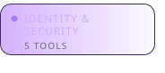</a>
<a href="#stack"></a>
<a href="#stack"></a>
<a href="#stack"></a>
<a href="#stack"></a>
<a href="#stack"></a>
<br>
<a href="#stack">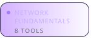</a>
<a href="#stack"></a>
<a href="#stack"></a>
<a href="#stack"></a>
<a href="#stack"></a>
<a href="#stack"></a>
<a href="#stack"></a>
<a href="#stack"></a>
<a href="#stack"></a>
<br>
<a href="#stack">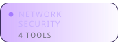</a>
<a href="#stack"></a>
<a href="#stack"></a>
<a href="#stack"></a>
<a href="#stack"></a>
<br>
<a href="#stack">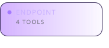</a>
<a href="#stack"></a>
<a href="#stack"></a>
<a href="#stack"></a>
<a href="#stack"></a>
<br>
<a href="#stack">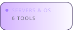</a>
<a href="#stack"></a>
<a href="#stack"></a>
<a href="#stack"></a>
<a href="#stack"></a>
<a href="#stack"></a>
<a href="#stack"></a>
<br>
<a href="#stack">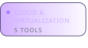</a>
<a href="#stack"></a>
<a href="#stack"></a>
<a href="#stack"></a>
<a href="#stack"></a>
<a href="#stack"></a>
<br>
<a href="#stack">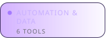</a>
<a href="#stack"></a>
<a href="#stack"></a>
<a href="#stack"></a>
<a href="#stack"></a>
<a href="#stack"></a>
<a href="#stack"></a>
<br>
<a href="#stack">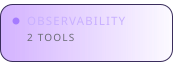</a>
<a href="#stack"></a>
<a href="#stack"></a>
<br>
<a href="#stack">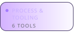</a>
<a href="#stack"></a>
<a href="#stack"></a>
<a href="#stack"></a>
<a href="#stack"></a>
<a href="#stack"></a>
<a href="#stack"></a>
</p>


### Running services

Everything I've built, as it runs today. Click a row to open it.

<a href="https://ysingh2103.github.io/retail-network/"></a>
<a href="https://ysingh2103.github.io/synapse/"></a>
<a href="https://github.com/ysingh2103/infra-lab"></a>
<a href="https://github.com/ysingh2103/docvault"></a>
<a href="https://github.com/ysingh2103/Ultron"></a>
<a href="https://ysingh2103.github.io"></a>


### Incident log

Real failures from my lab, written up like support tickets. Open one.

<details>
<summary><b>INC-07</b> · CoreDNS crash-looping with clean exit codes</summary>
<br>

| | |
|---|---|
| **Symptom** | CoreDNS kept restarting in k3s while reporting clean exit codes. Nothing had been broken on purpose; it surfaced in a routine health check. |
| **Root cause** | Memory exhaustion on the node, cascading into liveness-probe timeouts. Found by tracing the k3s service logs. |
| **Write-up** | [Read the full incident →](https://github.com/ysingh2103/infra-lab/blob/main/docs/07-resource-starvation-incident.md) |

</details>

<details>
<summary><b>Mail</b> · Users could send but nobody received anything</summary>
<br>

| | |
|---|---|
| **Symptom** | Outbound mail worked, inbound never arrived. Postfix looked healthy. |
| **Root cause** | Four faults stacked on one symptom: a version-breaking config change, duplicate definitions, an mbox file/directory mismatch and wrong group permissions between Postfix and Dovecot. |
| **Lab** | [infra-lab](https://github.com/ysingh2103/infra-lab) |

</details>

<details>
<summary><b>Tomcat</b> · The service refused to start after a deploy</summary>
<br>

| | |
|---|---|
| **Symptom** | Tomcat failed on start and served nothing. |
| **Root cause** | The installed Java version didn't match what that Tomcat release needs. Found in the startup log, not by guessing. |
| **Lab** | [infra-lab](https://github.com/ysingh2103/infra-lab) |

</details>

<details>
<summary><b>IIS</b> · A site wouldn't come up on its port</summary>
<br>

| | |
|---|---|
| **Symptom** | The site wouldn't serve on Windows Server. |
| **Root cause** | A port binding conflict with another site. |
| **Lab** | [infra-lab](https://github.com/ysingh2103/infra-lab) |

</details>


### Now

```
✅ Networking, Entra ID / Active Directory, Intune
✅ Linux administration and log analysis
✅ Web and app servers: IIS, Tomcat, NGINX
✅ SQL Server and PostgreSQL
✅ Docker and Kubernetes fundamentals (k3s)
✅ Observability: Prometheus and Grafana
🔄 DocVault: Windows leg (IIS + SQL Server Express)
🔄 Ultron: fault injection, then an Azure deployment
🔄 AZ-900 Azure Fundamentals
🔄 Python for automation
⬜ CI/CD with GitHub Actions
⬜ Terraform
```


<p align="center">
  <i>"Read the logs before you guess."</i><br><br>
  <a href="https://ysingh2103.github.io">ysingh2103.github.io</a> · <a href="https://ysingh2103.github.io/synapse/">Synapse</a> · <a href="https://linkedin.com/in/y-singh-gill">LinkedIn</a>
</p>
